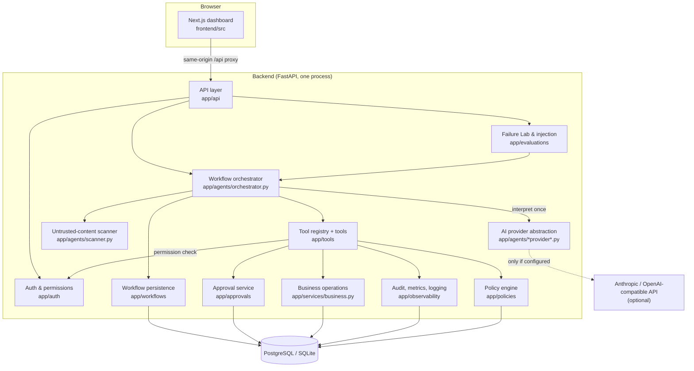
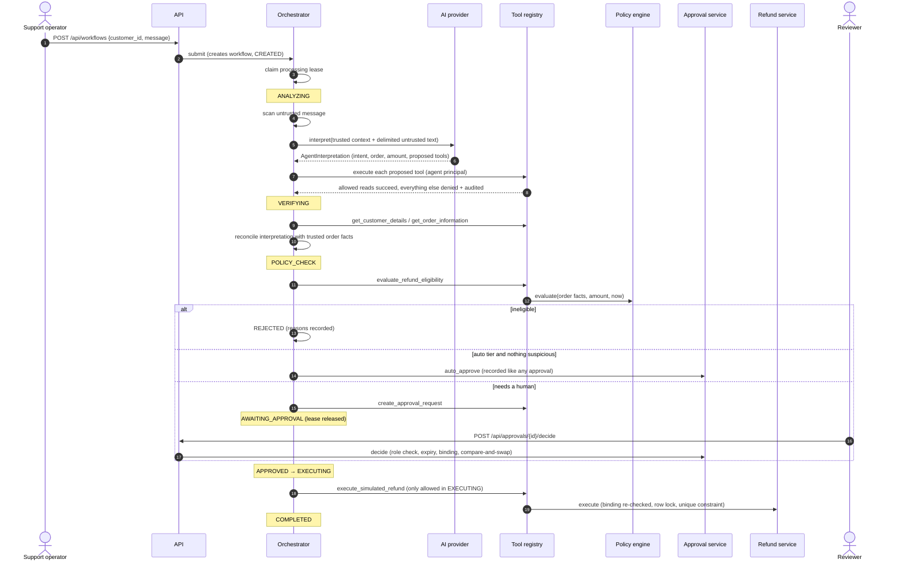
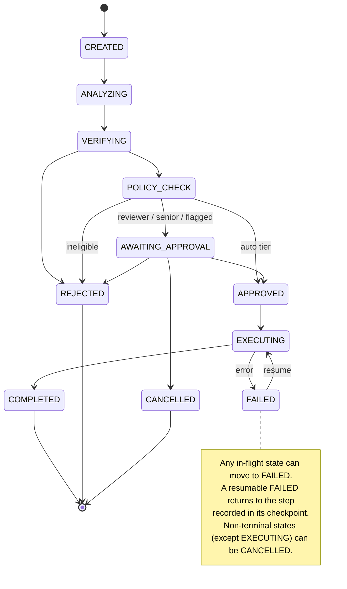
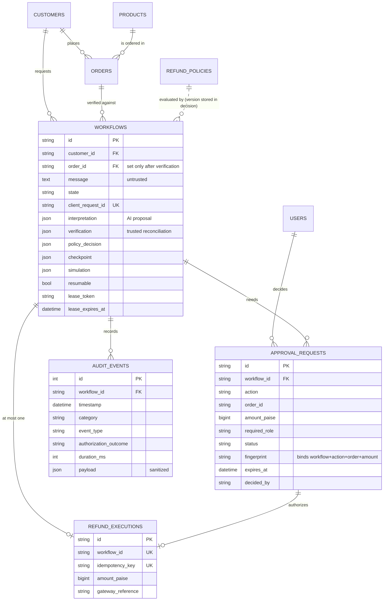

# AgentGuard Architecture

This document explains how AgentGuard is built and why. Every component named here exists in the repository; file paths are given so you can read the implementation alongside the explanation. The running application also describes itself: `GET /api/architecture` (and the **Architecture Explorer** page) returns the tool catalogue, the state-transition table and the permission matrix straight from the code.

## 1. System overview

AgentGuard is a **modular monolith**: one Python service (FastAPI) and one web app (Next.js), backed by PostgreSQL (Docker) or SQLite (local). There are no queues, workers or microservices. Engineering depth comes from correctness, not infrastructure.

### Component responsibilities

| Component | Path | Responsibility | Must never |
|---|---|---|---|
| Dashboard | `frontend/src` | Render state, submit requests, collect reviewer decisions | Make authorization or business decisions |
| API layer | `backend/app/api` | HTTP contracts, input validation, authentication, permission dependencies, error mapping | Contain business logic |
| Auth | `backend/app/auth` | Roles, permission matrix, principals, JWT, password hashing | Trust a role claimed by the client |
| Orchestrator | `backend/app/agents/orchestrator.py` | Drive the state machine; one step per state; checkpoint and commit after every step; recovery | Let model output authorize anything |
| AI providers | `backend/app/agents/` | Turn untrusted text into a structured, validated *proposal* | Execute tools themselves |
| Scanner | `backend/app/agents/scanner.py` | Flag instruction-like text so it escalates and is logged | Be relied on as a security boundary |
| Tool registry | `backend/app/tools/registry.py` | Gate every tool call on permission + workflow state, validate arguments, retry safely, audit outcomes | Run a tool that failed its checks |
| Policy engine | `backend/app/policies/engine.py` | Pure, deterministic eligibility and tier decisions | Consult an LLM |
| Approval service | `backend/app/approvals/service.py` | Create, bind, expire, invalidate and decide approvals | Accept a decision from an insufficient role |
| Workflow persistence | `backend/app/workflows/` | Transition table, compare-and-swap transitions, checkpoints, leases | Allow a transition not in the table |
| Business operations | `backend/app/services/business.py` | Orders, simulated gateway, idempotent refund execution | Refund the same workflow twice |
| Observability | `backend/app/observability/` | Audit events, metrics from stored data, JSON logs | Log credentials or unnecessary personal data |
| Failure Lab | `backend/app/evaluations/` | Run reproducible failure scenarios with executable assertions; inject faults | Report a pass that was not asserted |

## 2. Agent execution flow

A refund request is a **workflow**. The orchestrator has exactly one step function per active state. Each step does its work through the tool registry, saves a checkpoint, performs a validated transition and commits.

### What each step does

| State | Step | Leaves via |
|---|---|---|
| `CREATED` | nothing to do | `ANALYZING` |
| `ANALYZING` | scan the message; call the AI provider once; apply any simulated provider fault; run the agent's proposed tool calls through the authorization gate | `VERIFYING` |
| `VERIFYING` | resolve the order from **trusted** data (scoped to the customer); reconcile the amount; collect flags (low confidence, suspicious content) and discrepancies (wrong intent, conflicting statements, amount above balance) | `POLICY_CHECK`, or `REJECTED` if no order can be identified safely |
| `POLICY_CHECK` | load and evaluate the active policy; auto-approve, request an approval, or reject. Any flag or discrepancy forces human review even in the auto tier | `APPROVED`, `AWAITING_APPROVAL`, `REJECTED` |
| `AWAITING_APPROVAL` | waits for a human; no worker holds the workflow | `APPROVED`, `REJECTED`, `CANCELLED` |
| `APPROVED` | nothing to do | `EXECUTING` |
| `EXECUTING` | execute the simulated refund idempotently; record the result | `COMPLETED` |

Exceptions map to outcomes in one place (`WorkflowOrchestrator._advance`): transient tool or provider failures produce a **resumable** `FAILED`; authorization denials and validation failures produce a **non-resumable** `FAILED`; a lost compare-and-swap race stops the worker without overwriting anything.

### The workflow state machine

The transition table in `backend/app/workflows/states.py` is the single source of truth. `WorkflowService.transition` refuses anything not listed and records a security event when it does.

| From | Allowed next states |
|---|---|
| `CREATED` | `ANALYZING`, `CANCELLED`, `FAILED` |
| `ANALYZING` | `VERIFYING`, `CANCELLED`, `FAILED` |
| `VERIFYING` | `POLICY_CHECK`, `REJECTED`, `CANCELLED`, `FAILED` |
| `POLICY_CHECK` | `APPROVED`, `AWAITING_APPROVAL`, `REJECTED`, `CANCELLED`, `FAILED` |
| `AWAITING_APPROVAL` | `APPROVED`, `REJECTED`, `CANCELLED` |
| `APPROVED` | `EXECUTING`, `CANCELLED`, `FAILED` |
| `EXECUTING` | `COMPLETED`, `FAILED` (never cancelled mid-payment) |
| `FAILED` | `ANALYZING`, `VERIFYING`, `POLICY_CHECK`, `EXECUTING` (resume), `CANCELLED` |
| `COMPLETED`, `REJECTED`, `CANCELLED` | none (terminal) |

## 3. Tool execution

Tools are the only way the agent touches business systems. `ToolRegistry.execute` (`backend/app/tools/registry.py`) runs every call through the same pipeline:

1. **Lookup.** An unknown tool is denied and audited (`tool.unknown_requested`).
2. **Authorization.** The principal's role must hold the tool's permission, and the workflow must be in one of the tool's allowed states. Denials are audited (`tool.authorization_denied`) with the reason.
3. **Argument validation.** Inputs are Pydantic models with `extra="forbid"`, so an agent cannot smuggle flags like `bypass_policy=true` past validation.
4. **Execution with bounded retries.** Transient errors are retried only for idempotent tools, up to the tool's limit and `TOOL_MAX_ATTEMPTS`. Every retry is audited and committed.
5. **Data scoping inside handlers.** Order and customer lookups are restricted to the workflow's customer.
6. **Audit.** Success (`tool.executed`) or failure (`tool.failed`) with duration, attempts and a compact payload.

| Tool | Permission | Allowed states | Side effect | Max attempts |
|---|---|---|---|---|
| `get_customer_details` | `customer:read` | any | no | 3 |
| `get_order_information` | `order:read` | any | no | 3 |
| `retrieve_refund_policy` | `policy:read` | any | no | 3 |
| `evaluate_refund_eligibility` | `policy:evaluate` | any | no | 3 |
| `create_approval_request` | `approval:request` | `POLICY_CHECK` | yes (idempotent per workflow) | 3 |
| `check_approval_status` | `approval:read` | any | no | 3 |
| `execute_simulated_refund` | `refund:execute` | `EXECUTING` | yes (idempotent) | 3 |
| `get_workflow_status` | `workflow:read` | any | no | 3 |
| `update_customer_record` | `customer:update` | any | yes | 1 (never granted to the agent) |

## 4. Policy enforcement

`PolicyEngine.evaluate(order_facts, amount_paise, now)` is a pure function over **trusted** order facts loaded from the database. It returns every rule's result, the reasons, the tier and the required role. The active policy is stored as versioned JSON (`refund_policies` table), validated by `PolicyConfig`; administrators publish new versions with `PUT /api/policies`.

| Rule | Default |
|---|---|
| Eligible order statuses | `DELIVERED` |
| Refund window | 30 days from delivery (inclusive) |
| Amount | must be positive and within the remaining refundable balance; a fully refunded order is `already_refunded` |
| Partial refunds | allowed |
| Auto-approval tier | up to ₹2,000.00 inclusive |
| Reviewer tier | above ₹2,000.00 up to ₹10,000.00 inclusive |
| Senior reviewer tier | above ₹10,000.00 |
| Exception workflow | off; when enabled, ineligible requests go to a senior reviewer instead of being rejected |

Money is stored and compared as **integer paise** everywhere, so boundary checks such as ₹2,000.00 vs ₹2,000.01 are exact.

## 5. Authentication and authorization

- **Authentication:** `POST /api/auth/login` verifies a PBKDF2-SHA256 password hash (310,000 iterations) and issues an HS256 JWT. Every request resolves the token to a user **and re-reads the role from the database**, so a token cannot carry an escalated role.
- **Authorization:** API routes declare required permissions with `require(Permission.X)`. The tool registry checks the calling principal's permission again for every tool. The approval service checks the reviewer's role against the approval's required role. The frontend reads the permission list only to hide controls.
- **Principals:** human users, the **agent principal** (`agent:refund-agent`, least privilege) and the **system principal** (used for auto-approval and recovery bookkeeping).

The full permission matrix is in [SECURITY_MODEL.md](SECURITY_MODEL.md#4-permission-enforcement).

## 6. Workflow persistence, concurrency and recovery

| Mechanism | Where | Guarantees |
|---|---|---|
| Checkpoint after every step | `WorkflowService.checkpoint` | A crashed workflow knows which step to re-enter |
| Commit after every step | orchestrator steps | Nothing completed is lost in a crash |
| Compare-and-swap transitions | `WorkflowService.transition` | `UPDATE … WHERE state = <expected>`; a stale worker can never overwrite a newer state |
| Processing lease | `WorkflowService.claim/release` | Only one worker advances a workflow at a time; leases expire (`WORKFLOW_LEASE_SECONDS`) so a crashed worker cannot block forever |
| Compare-and-swap approval decisions | `ApprovalService.decide` | Two reviewers cannot both decide the same approval |
| Idempotent submission | unique `workflows.client_request_id` | Repeating a request (even concurrently) returns the original workflow |
| Idempotent execution | unique `refund_executions.workflow_id` and `idempotency_key`; order row lock; re-check after lock | At most one successful refund per workflow, even with concurrent workers |
| Bounded retries | tool registry | Transient failures retried, permanent ones not |
| Resume | `WorkflowOrchestrator.resume` | `FAILED` (resumable) → recorded step; in-flight → continue; terminal → audited no-op |
| Startup recovery | `recover_in_flight` (lifespan) | In-flight workflows left by a previous process are resumed when their lease is free |

**Crash windows covered by tests:** after each of `ANALYZING`, `VERIFYING`, `POLICY_CHECK`, `APPROVED`, and after the refund commit but before `COMPLETED` (`EXECUTION_COMMIT`). In the last case, resuming replays the stored execution (`execution.replayed`) instead of paying twice.

**Simulation note:** an injected interruption raises inside the request and releases the workflow's lease on the way out, so it can be resumed immediately. A real process crash leaves the lease to expire after `WORKFLOW_LEASE_SECONDS`.

## 7. Failure recovery and failure injection

`FailureInjector` (`backend/app/evaluations/failure_injection.py`) provides deterministic faults. Counters are persisted on the workflow, so a resumed workflow does not hit the same injected failure forever.

| Injection | Configured by | Effect |
|---|---|---|
| `fail_tool` + `fail_times` + `fail_mode` | per workflow (`simulation`) | the named tool raises transient or permanent errors |
| `gateway_fail_times` | per workflow | simulated payment gateway timeouts |
| `db_fail_times` | per workflow | failure after the gateway call, before the database commit |
| `interrupt_after` | per workflow | simulated crash after a state or after `EXECUTION_COMMIT` |
| `provider_fault` | per workflow | `misread_amount`, `wrong_intent` or `low_confidence` |
| global injections (`tool:<name>`, `gateway`, `db:refund_commit`, `provider`) | administrators via `/api/admin/failure-injections` | apply to every workflow until cleared |

## 8. Data model

Other tables: `users`, `customers`, `products`, `orders` (amounts in paise, `refunded_paise` tracked), `refund_policies` (versioned JSON config) and `lab_runs` (persisted Failure Lab results). Indexes cover the workflow state, creation time, approval status and audit lookups by workflow and category. The schema is managed by Alembic (`backend/migrations`); a test asserts the migration matches the models exactly.

## 9. API contracts

All endpoints are under `/api` and return JSON. Errors share one shape: `{"error": {"code": "...", "message": "...", "details": {...}}}` with codes such as `authentication_required` (401), `permission_denied` (403), `not_found` (404), `conflict` / `invalid_transition` / `concurrent_update` / `workflow_busy` (409) and `validation_failed` (422). Interactive documentation is served at `/docs`.

| Method | Path | Permission | Notes |
|---|---|---|---|
| POST | `/api/auth/login` | none | returns a bearer token and the user's permissions |
| GET | `/api/auth/me` | authenticated | current user |
| GET | `/api/auth/demo-users` | none | demo accounts; empty in production |
| GET | `/api/health` | none | provider, database, version |
| GET | `/api/customers`, `/api/customers/{id}` | `customer:read` | |
| GET | `/api/customers/{id}/orders`, `/api/orders`, `/api/orders/{id}` | `order:read` | |
| GET | `/api/policies/active`, `/api/policies` | `policy:read` | active policy, version history |
| PUT | `/api/policies` | `policy:manage` | publishes a new validated version |
| POST | `/api/workflows` | `workflow:create` | `201` created; `200` for a repeated `client_request_id`; `202` when a simulated interruption fired (state persisted) |
| GET | `/api/workflows`, `/api/workflows/{id}` | `workflow:read` | filter by `state`, `customer_id`; paginated |
| GET | `/api/workflows/{id}/events` | `audit:read` | the workflow's audit timeline |
| POST | `/api/workflows/{id}/resume` | `workflow:resume` | `409 workflow_busy` if another worker holds it |
| POST | `/api/workflows/{id}/cancel` | `workflow:cancel` | invalidates pending approvals |
| GET | `/api/approvals`, `/api/approvals/{id}` | `approval:read` | filter by `status` |
| POST | `/api/approvals/{id}/decide` | `approval:read` + role check in the service | `{"decision": "approve" \| "reject", "comment"}` |
| GET | `/api/events` | `audit:read` | filter by `category`, `event_type`, `workflow_id`, `severity` |
| GET | `/api/security/events`, `/api/security/summary` | `security:read` | denied actions and security events |
| GET | `/api/metrics/overview` | `metrics:read` | computed from stored records |
| GET | `/api/architecture` | `workflow:read` | live tool catalogue, transitions, permission matrix |
| GET | `/api/failure-lab/scenarios`, `/api/failure-lab/runs` | `failure_lab:run` | |
| POST | `/api/failure-lab/scenarios/{key}/run` | `failure_lab:run` | runs real workflows and returns assertion results |
| GET | `/api/playground/examples` | `workflow:read` | |
| GET/POST/DELETE | `/api/admin/failure-injections` | `admin:failure_injection` | global fault injection |
| POST | `/api/admin/reset-demo-data` | `admin:seed` | demo environments only |

## 10. Key design decisions

**1. An explicit state machine instead of LangGraph (for v1).** The workflow is a fixed, linear pipeline with one human wait and well-defined failure exits. A hand-written state machine over a transition table keeps every rule visible in about one screen of code, persists naturally into ordinary database rows (the same rows the dashboard reads), and makes compare-and-swap transitions, leases and idempotent resumption straightforward. LangGraph would add a dependency, a separate checkpoint store and an abstraction layer without enabling anything this workflow needs. *Trade-off:* branching multi-agent plans or dynamic tool loops would justify a graph framework; the orchestrator's step table is the place to introduce one later.

**2. The LLM is consulted once, for interpretation only.** The agent proposes; deterministic code verifies, decides and executes. This bounds what a manipulated or mistaken model can do, makes behavior testable, and keeps cost predictable.

**3. A deterministic mock provider is the default.** Tests, the Failure Lab and offline workshops behave identically every time and need no paid credentials. Its `comply` mode deliberately simulates a model that obeys injected instructions, so the backend defenses are exercised rather than assumed.

**4. Audit events share the business transaction.** A committed change always has its audit record; a rolled-back change never does. Security denials are committed explicitly before the error is returned.

**5. Integer paise for money.** No floating point anywhere in eligibility or execution.

**6. SQLite for zero-setup local runs, PostgreSQL for Docker.** Portable column types (`UTCDateTime`, JSON→JSONB) keep behavior identical; the full test suite runs on both.

**7. Same-origin API proxy.** The browser calls `/api/*` on the Next.js origin, which rewrites to the backend. No CORS configuration is needed and the backend can stay private in Docker. The rewrite target is fixed at build time (`API_INTERNAL_URL`).

**8. A modular monolith.** Clear package boundaries with dependency injection through constructors, and no distributed infrastructure added for appearance's sake.

## 11. Frontend

Next.js 16 (App Router) with TypeScript, Tailwind CSS v4 theme tokens, React Flow for the state-machine and component graphs, and Recharts for metrics. Pages are client components that call the API through a small typed client (`src/lib/api.ts`). The session token is held in `sessionStorage` and attached as a bearer token; a `401` response signs the user out.

| Page | Route | Data |
|---|---|---|
| Overview | `/` | `/api/metrics/overview`, recent workflows, health |
| Agent Playground | `/playground` | submit requests, examples, result panels, audit timeline |
| Workflow Explorer | `/workflows`, `/workflows/{id}` | state graph from the audit trail, approvals, checkpoint, resume/cancel |
| Approval Center | `/approvals` | pending approvals and decision history |
| Security Monitor | `/security` | security events and denied tools (requires `security:read`) |
| Failure Lab | `/failure-lab` | run scenarios, assertions, events, run history |
| Audit Timeline | `/audit` | filterable event stream |
| Architecture Explorer | `/architecture` | `/api/architecture` |
